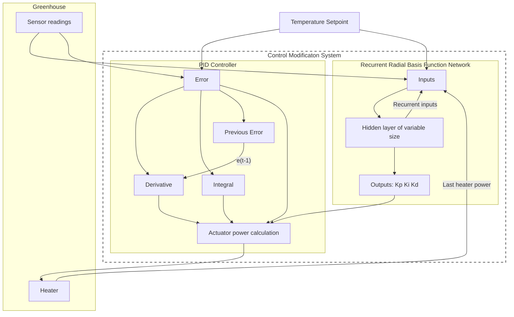

# Architecture Diagrams: Current vs Proposed Integration

---

## Current Architecture (Tightly Coupled)

```
┌─────────────────────────────────────────────────────────────────┐
│                        ControlSystem                            │
│                                                                 │
│  • RBF Network (learning)                                      │
│  • PID Controller (gains)                                      │
│  • Logger                                                      │
│  • Clock                                                       │
│                                                                 │
│  simulator: *GreenhouseSimulator ←── TIGHT COUPLING!           │
│                                                                 │
│  step() {                                                      │
│    state = simulator.GetState()        ← Only option           │
│    simulator.Step(heater)              ← Only option           │
│  }                                                             │
└─────────────────────────────────────────────────────────────────┘
                                ↓↓↓ Direct dependency
                    *GreenhouseSimulator
                    (only implementation)
                    ├─ GetState()
                    ├─ Step()
                    └─ Close()
```

**Problem**: ControlSystem is locked into using `GreenhouseSimulator`. If you want to use `RealGreenhouseEnvironment`, you must rewrite parts of ControlSystem.

---

## Entire System Overview

Choose one of these visual representations for the final version:

### Mermaid Diagram



## Proposed Architecture (Interface-Based)

```
┌─────────────────────────────────────────────────────────────────┐
│                        ControlSystem                            │
│                                                                 │
│  • RBF Network (learning)                                      │
│  • PID Controller (gains)                                      │
│  • Logger                                                      │
│  • Clock                                                       │
│                                                                 │
│  environment: GreenhouseEnvironment ←── INTERFACE!             │
│                                                                 │
│  step() {                                                      │
│    state, err = environment.ReadSensors()   ← Any impl         │
│    environment.SendControl(heater)          ← Any impl         │
│  }                                                             │
└─────────────────────────────────────────────────────────────────┘
                                ↓↓↓ Dependency Inversion
                    GreenhouseEnvironment
                    (interface - many implementations)
                    ├─ ReadSensors() → GreenhouseState, error
                    ├─ SendControl(power) → error
                    ├─ GetCurrentHeaterPower() → float64
                    └─ Close() → error
                                ↓
                    ┌───────────────────┬──────────────────┐
                    │                   │                  │
        ┌───────────────────┐  ┌──────────────────────┐  ┌──────────────────┐
        │ GreenhouseSimulator│  │ RealGreenhouse      │  │ OtherImplements  │
        │                   │  │ Environment         │  │                  │
        │ • GetState()      │  │ • ReadSensors()     │  │ • MockEnv        │
        │ • Step()          │  │ • SendControl()     │  │ • NetworkEnv     │
        │ • Close()         │  │ • Close()           │  │ • RecordingEnv   │
        └───────────────────┘  └──────────────────────┘  └──────────────────┘
```

**Benefit**: ControlSystem works with ANY implementation. Easy to swap for testing, deployment, or future extensions.

---

## Usage Comparison

```go
// OPTION 1: Use simulator (same as before)
func main() {
    env := NewGreenhouseSimulator(...)
    
    system := &ControlSystem{
        environment: env,  ← Accepts interface
        ...
    }
    
    system.Run(ctx, 5*time.Minute)
}

// OPTION 2: Use real hardware (same ControlSystem code)
func main() {
    sensors := NewDHTSensors()
    actuators := NewPWMHeater("GPIO18")
    
    env, _ := NewRealGreenhouseEnvironment(sensors, actuators, ...)
    
    system := &ControlSystem{
        environment: env,  ← Same interface, different implementation
        ...
    }
    
    system.Run(ctx, 24*time.Hour)
}

// OPTION 3: Use mock for testing
func main() {
    env := &MockEnvironment{
        readings: []GreenhouseState{...},
        errors: []error{...},
    }
    
    system := &ControlSystem{
        environment: env,
        ...
    }
    
    system.Run(ctx, 1*time.Minute)
}

// ✅ All use identical ControlSystem code
// ✅ No duplication
// ✅ Easy to switch via flags or config
```

---

## Data Flow


```
Simulation/Real/Test Cycle:
  ↓
[ControlSystem.step()]
  ↓
state, err := environment.ReadSensors()        ← Interface method
  ↓
[Compute error, RBF, PID] ###################### TODO: isnt PID before?
  ↓
environment.SendControl(heaterPower)           ← Interface method
  ↓
[Implementation handles details:
  ├─ Simulator: advances internal state
  ├─ Real HW: sends to GPIO/actuator
  ├─ Mock: records command
  └─ Network: sends HTTP POST]
  ↓
Next cycle
```

**All operations work through interface - implementation details hidden**

---

## Method Mapping: How to Adapt Each Type

### GreenhouseSimulator → GreenhouseEnvironment

```
┌──────────────────────────────┐      ┌─────────────────────────────┐
│  GreenhouseSimulator         │      │  GreenhouseEnvironment      │
│  (current type)              │  →   │  (interface)                │
├──────────────────────────────┤      ├─────────────────────────────┤
│ GetState() GreenhouseState   │      │ ReadSensors() (State, err) │
│                              │      │                             │
│ Step(power float64) State    │      │ SendControl(power float64) │
│                              │      │     → error                 │
│                              │      │                             │
│ GetState()                   │      │ GetCurrentHeaterPower()    │
│   .HeaterPowerOutput         │  →   │     → float64              │
│                              │      │                             │
│ (no-op)                      │      │ Close() → error            │
└──────────────────────────────┘      └─────────────────────────────┘
```

**Adaptation:**
```go
// ReadSensors() adapter
func (g *GreenhouseSimulator) ReadSensors() (GreenhouseState, error) {
    return g.GetState(), nil
}

// SendControl() adapter
func (g *GreenhouseSimulator) SendControl(power float64) error {
    g.Step(power)
    return nil
}

// GetCurrentHeaterPower() adapter
func (g *GreenhouseSimulator) GetCurrentHeaterPower() float64 {
    return g.GetState().HeaterPowerOutput
}

// Close() adapter
func (g *GreenhouseSimulator) Close() error {
    return nil
}
```

### RealGreenhouseEnvironment → GreenhouseEnvironment

```
┌──────────────────────────────┐      ┌─────────────────────────────┐
│  RealGreenhouseEnvironment   │      │  GreenhouseEnvironment      │
│  (real hardware bridge)      │  →   │  (interface)                │
├──────────────────────────────┤      ├─────────────────────────────┤
│ ReadSensors()                │      │ ReadSensors() (State, err) │
│ HardwareSensors interface    │      │     ✓ Already matches!      │
│                              │      │                             │
│ SendControl(ControlOutput)   │      │ SendControl(power float64) │
│ HardwareActuators interface  │  →   │     → error                 │
│                              │      │                             │
│ GetCurrentHeaterPower()      │      │ GetCurrentHeaterPower()    │
│                              │      │     ✓ Already matches!      │
│                              │      │                             │
│ Close()                      │      │ Close() → error            │
│                              │      │     ✓ Already matches!      │
└──────────────────────────────┘      └─────────────────────────────┘
```

**Already compatible!** (Minor type conversions needed)

---

## Component Interactions

### BEFORE

```
┌─────────────────┐
│  main()         │
└────────┬────────┘
         │
         ├─→ NewGreenhouseSimulator()
         ├─→ NewRecurrentRBFNetwork()
         ├─→ NewAdaptivePIDController()
         │
         └─→ ControlSystem{
                 simulator: ↑
                 rbfNetwork: ↑
                 pidCtrl: ↑
                 ...
             }
             │
             └─→ Run()
                 └─→ step()
                     └─→ simulator.GetState()
                     └─→ simulator.Step()
```

**Single path, tightly coupled**

### AFTER

```
┌─────────────────┐
│  main()         │
└────────┬────────┘
         │
    ┌────┴────┐
    │          │
    v          v
  (Sim)     (Real)    (Mock)
    │          │         │
    └────┬─────┴─────┬───┘
         │           │
         v           v
    NewGreenhouseSimulator()    NewRealGreenhouseEnvironment()    MockEnvironment()
    NewDHTSensors()             NewPWMHeater()
         │                       │                                 │
         └────┬─────────────────┴──────────────────┬───────────────┘
              │                                    │
              └────→ GreenhouseEnvironment (interface)
                                   ↑
                                   │
                          ControlSystem{
                              environment: ↑
                              rbfNetwork: ...
                              pidCtrl: ...
                              ...
                          }
                                   │
                                   └─→ Run()
                                       └─→ step()
                                           └─→ environment.ReadSensors()
                                           └─→ environment.SendControl()
```

**Multiple paths, loosely coupled, flexible**

---

## Testing Architecture Comparison

### BEFORE (Simulator-Based Testing Only)

```
┌──────────────────────────────────────────────┐
│         Test Suite                           │
│                                              │
│  test_1: ControlSystem + Simulator           │
│  test_2: ControlSystem + Simulator           │
│  test_3: ControlSystem + Simulator           │
│  ...                                         │
│                                              │
│  ❌ All tests use same simulator             │
│  ❌ Hard to inject errors                    │
│  ❌ Hard to test error handling              │
│  ❌ Can't test with real hardware (in tests) │
└──────────────────────────────────────────────┘
```

### AFTER (Flexible Testing)

```
┌──────────────────────────────────────────────────────┐
│         Test Suite                                   │
│                                                      │
│  test_1: ControlSystem + Simulator                   │
│  test_2: ControlSystem + Mock (success case)         │
│  test_3: ControlSystem + Mock (sensor error)         │
│  test_4: ControlSystem + Mock (control error)        │
│  test_5: ControlSystem + Mock (stale data)           │
│  test_6: ControlSystem + Recording (playback)        │
│  test_7: ControlSystem + Hybrid (sim + real)         │
│  ...                                                 │
│                                                      │
│  ✅ Multiple implementations possible                │
│  ✅ Easy to inject errors                           │
│  ✅ Comprehensive error handling tests               │
│  ✅ Integration tests with real hardware            │
└──────────────────────────────────────────────────────┘
```

---

## Deployment Scenarios

```
Development               Production
    ↓                         ↓
Simulator            RealGreenhouseEnvironment
    ↓                    (DHT22 + GPIO heater) # TODO: FIX!
ControlSystem       ←─ Same code runs both!
    ↓                    ↓
Test results       Real greenhouse operating
```

---

## Conclusion

The proposed interface-based architecture enables:
- ✅ **Flexible deployment** (test with sim, deploy to real HW)
- ✅ **Better testing** (mocks, error injection, edge cases)
- ✅ **Code reuse** (single ControlSystem for all)
- ✅ **Future-proof** (add new implementations easily)
- ✅ **Clean architecture** (follows SOLID principles)

**Recommended**: Implement this refactoring before first production deployment.
